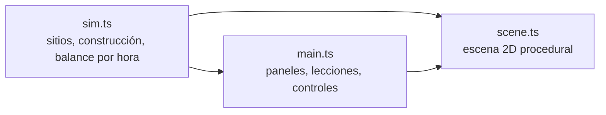
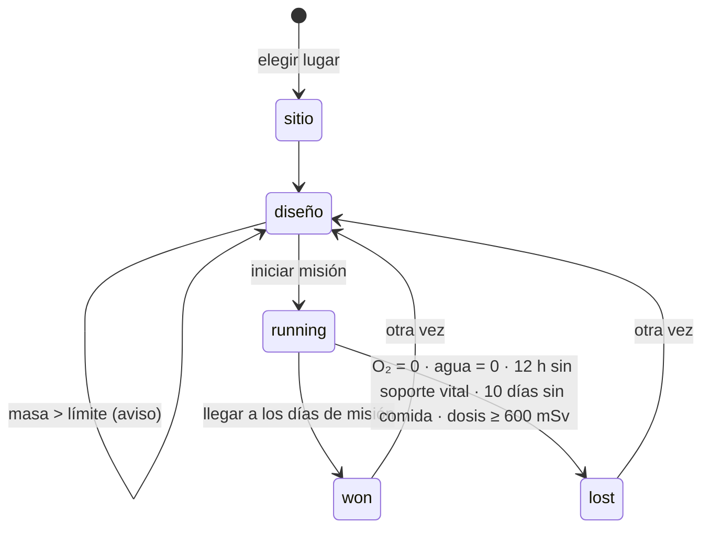

# Base lunar y marciana: mapa de la lógica

Cómo funciona por dentro el simulador de base (`app/src/`). Toda la lógica está en `sim.ts` (pura, con tests); `scene.ts` dibuja y `main.ts` arma la interfaz.

## 1. Capas

| Archivo | Responsabilidad | Pruebas |
|---|---|---|
| `sim.ts` | Sitios, masa de lanzamiento, estado, eventos aleatorios, balance horario de energía, agua, oxígeno, comida y radiación, victoria y derrota | `sim.test.ts` (7) |
| `scene.ts` | Paisaje, día y noche, polvo, módulos de la base (Canvas 2D) | manual |
| `main.ts` | Elección del sitio, diseño con límite de masa, lecciones, controles de tiempo, gráficos | manual |

## 2. Ciclo del juego

## 3. El paso horario (`step`)

Orden dentro de cada hora:

1. **Eventos aleatorios** (probabilidad por hora):
   - Tormenta solar: 1 cada 120 días, dura 18 h.
   - Tormenta de polvo en Marte: 1 cada 200 días, dura de 20 a 60 días.
   - Falla del reciclador: 1 cada 90 días, dura de 2 a 5 días.
   - Limpieza de los paneles por viento en Marte: 1 cada 60 días si el polvo supera el 15 %; quita el 60 % del polvo.
2. **Ambiente:**
   - En Marte, la profundidad óptica es 0.5 (3.5 con tormenta) y el polvo de los paneles sube 0.2 % por sol.
   - Sol: en el ecuador lunar es sinusoidal con días de 708.7 h; en el polo sur es rasante el 85 % del tiempo; en Marte el sol dura 24.66 h.
3. **Energía:**
   - Paneles: `flujo × geometría × e^(−0.6τ) × (1 − polvo) × m² × 0.30`.
   - Reactor: 10 kWe por unidad.
   - Batería: suma y resta la diferencia.
   - Cargas en orden de prioridad: soporte vital (incluye calefacción nocturna), reciclador, electrólisis, minería de hielo, ISRU de CO₂, invernadero. Las últimas se **apagan** primero si falta energía.
4. **Flujos por persona y día:** 0.84 kg de O₂, 4 kg de agua, 1.8 kg de comida.
   - Reciclador: recupera el 98 % del agua.
   - Electrólisis: 1.125 kg de agua y ~6 kWh por kg de O₂.
   - ISRU de CO₂: ~25 kWh por kg de O₂.
   - Hielo: ~3 kWh por kg de agua.
   - Invernadero: ~40 g de comida por m² y día; 0.2 kW/m².
5. **Radiación:**
   - Dosis de fondo: `GCR × 0.7 × (0.45 + 0.55 e^(−cm/60))`.
   - Durante una tormenta solar: `60/18 mSv por hora × 0.7 × e^(−cm/12)`.
   - Fondo en superficie: Luna 1.37 mSv/día (Chang'e-4) y Marte 0.67 mSv/día (Curiosity/RAD).
6. **Derrota y contabilidad:** horas de frío, días con hambre, ciencia (~6 h por astronauta y día si no se apagó nada) e historial diario.

## 4. Masa de lanzamiento

| Elemento | Masa |
|---|---|
| Hábitat (2 personas) | 5 000 kg |
| Paneles | 12 kg/m² |
| Baterías | 6 kg/kWh |
| Reactor | 1 800 kg |
| Reciclador | 500 kg |
| Electrólisis | 80 kg por kg/día |
| ISRU | 220 kg por kg/día |
| Minería de hielo | 150 kg por kg/día |
| Invernadero | 30 kg/m² |
| Víveres | días × tripulación × 6.64 kg |
| Blindaje de regolito | material local: no suma masa |

## 5. Lecciones (escenarios que fallan por una razón real)

| Lección | Resultado esperado (probado) |
|---|---|
| Base Artemis en el polo sur | Completa 180 días |
| Noche lunar sin reactor | Se congela en la primera noche de 14 días |
| Con reactor | Sobrevive la noche |
| Polvo en Marte | Una tormenta deja la base solar sin energía |
| Radiación sin blindaje | Alcanza el límite de 600 mSv |

## 6. Aleatoriedad

`rng(seed)` (mulberry32): la misma construcción con la misma semilla repite exactamente los mismos eventos (probado).

## 7. Pendiente

- Llevar a esta base la tripulación y la fecha de un alunizaje del juego *Δv Mission Control*.
- Reabastecimiento con cargueros (ventanas y costo de masa).
