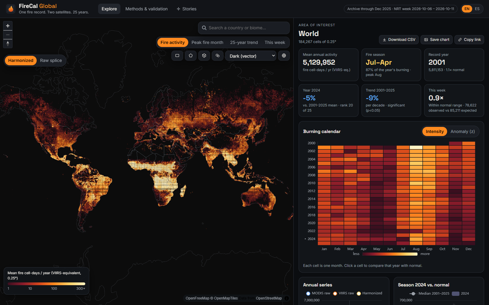
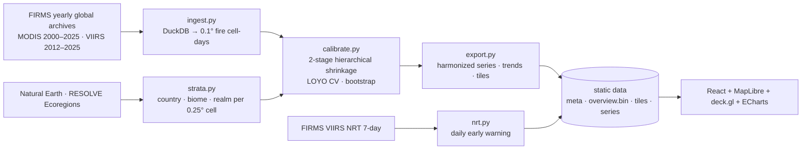
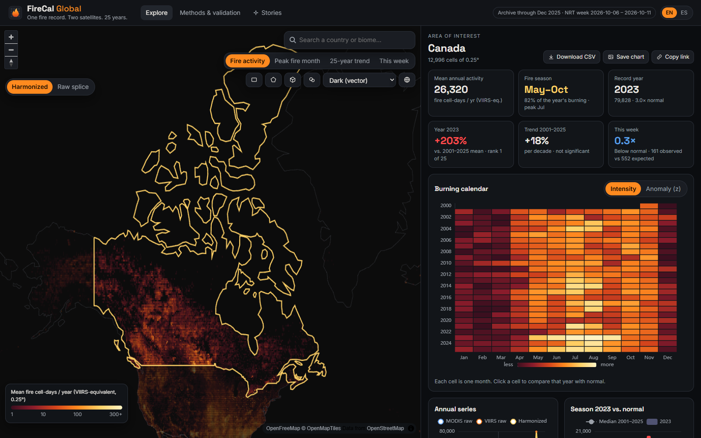
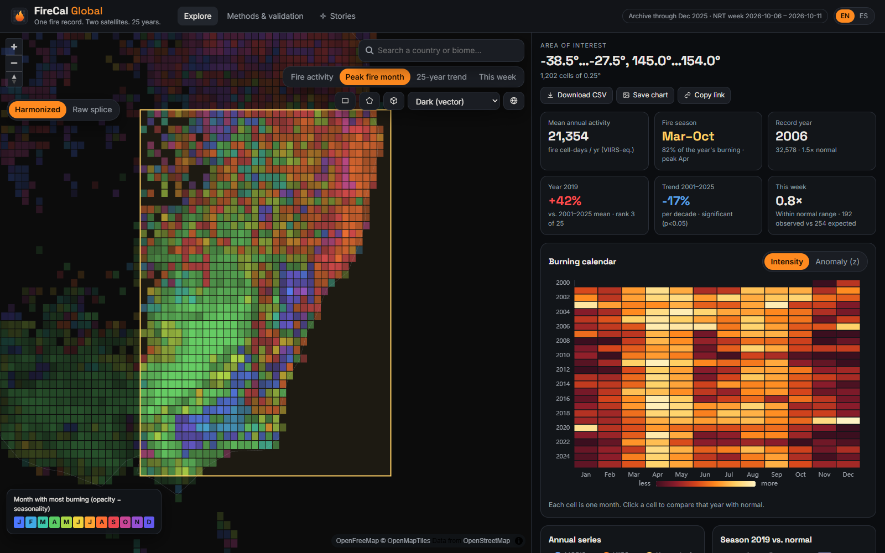
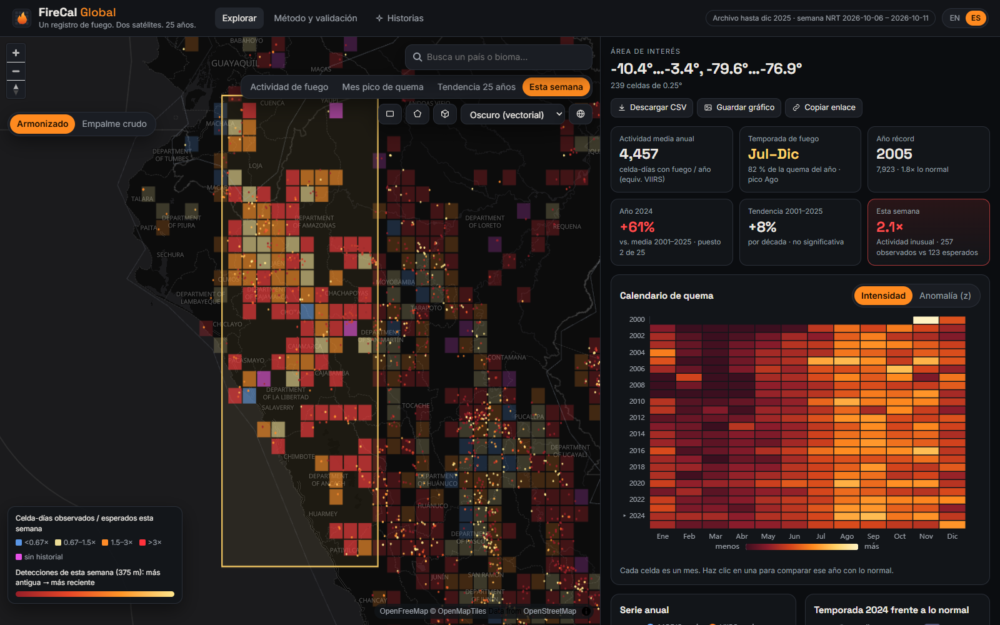
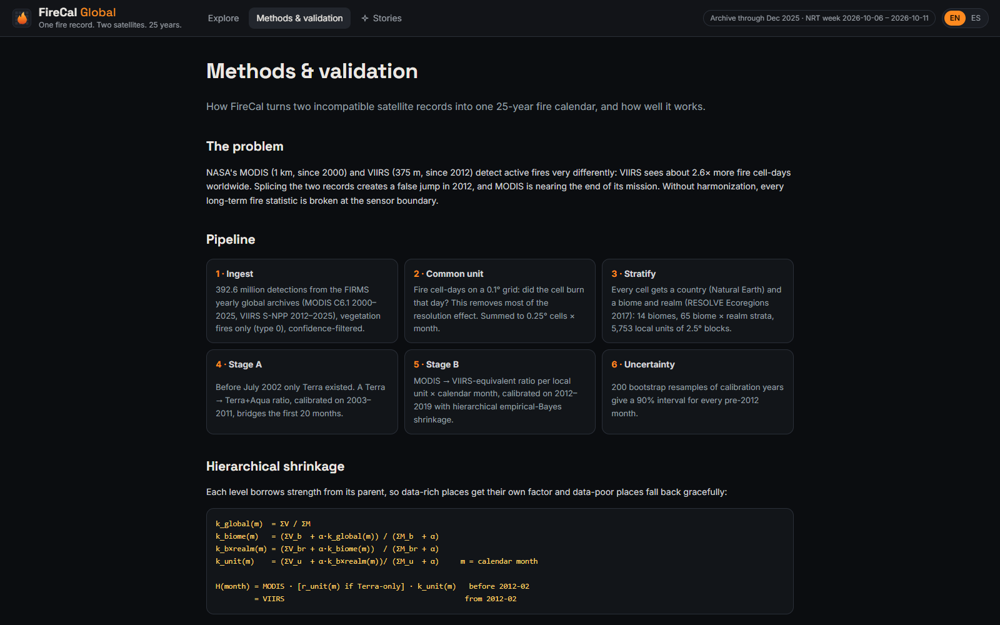

# FireCal Global

**One fire record. Two satellites. 25 years.**

FireCal harmonizes NASA's MODIS (2000–) and VIIRS (2012–) active-fire records into a single, consistent **burning calendar for any place on Earth**: a country, a biome, or a rectangle or polygon you draw. It also compares **this week's** VIIRS detections against 25 years of history as an early-warning signal.

> NASA Space Apps Challenge 2026 · Challenge: *Harmonization of MODIS and VIIRS Hot Spots*
> Full documentation (Spanish): [`docs/`](docs/README.md).



## Why it matters

MODIS and VIIRS see fire very differently. VIIRS (375 m) records about **2.6× more** fire cell-days than MODIS (1 km). Splicing the two records as-is creates an artificial **+148% jump in global fire activity in 2012**; after harmonization the change is **−4%**. MODIS is also nearing the end of its mission, so without harmonization every long-term fire statistic breaks at the sensor boundary, right when fire managers need the long view most.

## What FireCal does

| | |
|---|---|
| **Burning calendar** | Year × month heatmap, 2000–2025, for any AOI. Intensity or anomaly (z-score) view. |
| **Critical periods** | The fire season (the shortest run of months holding 80% of activity), record years, months far above normal (z ≥ 2). |
| **Long-term change** | Theil–Sen trend with Mann–Kendall test, plus Benjamini–Hochberg false-discovery control across 110 k cells. |
| **Early warning** | Last complete days of the global 7-day VIIRS NRT file vs. the harmonized climatology of the same calendar days, with a Poisson test. Static industrial sources masked. Updated daily by CI. |
| **4 global map layers** | Fire activity · Peak fire month · 25-year trend · This week. Cells are drawn as crisp vector geometry at any zoom, with an optional smooth GPU heatmap and 3D columns. In *This week*, every VIIRS 375 m detection is a vector point. Basemaps: OpenFreeMap vector dark, NASA GIBS Black Marble and Blue Marble. |
| **Open & portable** | CSV export of every series, PNG export of charts, shareable URLs, English/Spanish, works on phones. Fully static site. |

## Results (leave-one-year-out validation, 2012–2019)

Each year is held out in turn: we calibrate without it, predict its VIIRS record from MODIS, and measure the error in fire cell-days.

| Method | MAE · 2.5° block × month | MAE · country × year | Bias |
|---|---:|---:|---:|
| MODIS, no adjustment | 126.0 | 13,860 | −62.0% |
| One global factor | 60.4 | 3,931 | 0.0% |
| Biome × month | 52.1 | 2,937 | 0.1% |
| Biome × realm × month | 48.8 | 2,411 | 0.2% |
| **FireCal hierarchical** | **28.1** | **943** | **−0.2%** |

- **Out-of-window test.** Calibrated on 2012–2019 and used to predict 2020–2025, the country × year MAE is 1,532 with −0.4% bias.
- **Stage A, Terra → Terra+Aqua.** Before July 2002 only Terra existed. Correcting those months cuts block × month MAE from 66.4 to 16.8, and bias from −61% to 0.0%.
- **Scale of the run.** 392.6 million detections (MODIS 111.4 M, VIIRS 281.1 M) → 184,267 burning 0.25° cells, 233 countries, 14 biomes.

## Method in one paragraph

Both sensors are reduced to the same unit, **fire cell-days** on a 0.1° grid (did this cell burn on this day?), then summed to 0.25° cells × month. Every cell gets a country (Natural Earth), a biome and a realm (RESOLVE Ecoregions 2017). In the overlap window, the MODIS → VIIRS ratio is estimated per **2.5° block × biome × realm × calendar month**. Each level of the hierarchy is shrunk toward its parent (global → biome → biome × realm → local unit) with an empirical-Bayes pseudo-count α. α = 30 was chosen by cross-validation. A bootstrap over calibration years gives the 90% band shown for every pre-2012 month. Full details, equations and limitations are on the in-app **Methods & validation** page.



## Screens

| Country: Canada 2023, the record season | Drawn AOI: SE Australia, peak fire month |
|---|---|
|  |  |
| **This week (ES): northern Andes of Peru, 2.1× expected** | **Methods & validation** |
|  |  |

Also in `media/`: `firecal_globe.mp4` (10 s rotating globe rendered in Blender from the harmonized data), `globe.png` and `screens/mobile.jpg`.

## Run it

**Requirements:** Python 3.12+ and Node 20+.

```bash
python -m venv .venv
```

```bash
.venv/Scripts/pip install -r requirements.txt pytest
```

Use `.venv/bin/pip` on macOS or Linux.

Full pipeline: about 7 GB of downloads on the first run, then about 10 minutes of processing.

```bash
.venv/Scripts/python pipeline/run_all.py
```

Daily early-warning refresh. It only needs `data/state/nrt_state.npz`.

```bash
.venv/Scripts/python pipeline/nrt.py --download
```

Web app:

```bash
cd app && npm ci && npm run dev
```

Tests and a production build:

```bash
.venv/Scripts/python -m pytest tests -q
```

```bash
cd app && npm run build
```

The production build in `app/dist` is a plain static site and can be served from GitHub Pages, Vercel or any file server. `.github/workflows/nrt-pages.yml` refreshes the early warning every day and redeploys to GitHub Pages.

## Repository layout

```
pipeline/   download · ingest · strata · calibrate · export · nrt · run_all
app/        React + TypeScript + Vite front end (data in app/public/data)
tests/      unit tests for the science core and the binary tile format
media/      Blender globe scene (globe_scene.py), renders, screenshots
data/state/ compact state for daily NRT updates (raw + interim data are not versioned)
archive/    v1: the first Peru-only prototype
```

## Limitations

- Active-fire detections are not burned area: small, short or cloud-covered fires can be missed by both sensors.
- Fire cell-days measure *whether* a 0.1° cell burned, not how intensely. Fire radiative power is not harmonized yet.
- NRT data are provisional and carry no vegetation-fire flag. Static sources are masked from the archive, but some may remain.
- The factors assume the MODIS–VIIRS relationship of 2012–2019 also held in 2000–2011. The 2020–2025 out-of-window test supports this, but it cannot be checked directly before 2012.
- Calendar years split southern-hemisphere seasons (for example Dec 2019 – Jan 2020 in Australia). The critical-months table shows them as one event.

## Data & credits

- **NASA FIRMS:** MODIS Collection 6.1 (MCD14ML) and VIIRS S-NPP 375 m (VNP14IMGML; NRT VNP14IMGTDL_NRT) active fire data. https://firms.modaps.eosdis.nasa.gov
- **NASA GIBS** basemaps (VIIRS Black Marble, Blue Marble) and the **NASA Visible Earth** Blue Marble texture used in the globe render.
- **RESOLVE Ecoregions 2017** (Dinerstein et al., 2017, *BioScience*), CC-BY 4.0. **Natural Earth** boundaries, public domain. Esri dark gray basemap.
- Giglio, Schroeder & Justice (2016), *Remote Sensing of Environment* 178; Schroeder et al. (2014), *Remote Sensing of Environment* 143.

Code: MIT (see `LICENSE`). Data keep their original licenses.

---

### Resumen en español

FireCal armoniza los registros de focos de calor MODIS (desde 2000) y VIIRS (desde 2012) de NASA en un solo **calendario de quema** para cualquier lugar del mundo, y compara **esta semana** con 25 años de historia como alerta temprana.

- **Calibración:** jerárquica por bioma, reino y bloque de 2.5°, en dos etapas: Terra → Terra+Aqua y luego MODIS → VIIRS.
- **Validación:** dejando un año fuera, el error baja de 126 a 28 celda-días por bloque y mes, con sesgo de −0.2 %.
- **El salto de 2012:** empalmar los datos crudos crea un salto falso de +148 % en 2012; con la armonización queda en −4 %.
- **La app:** en inglés y español, funciona en celular, exporta CSV y se actualiza a diario con datos casi en tiempo real (NRT).
