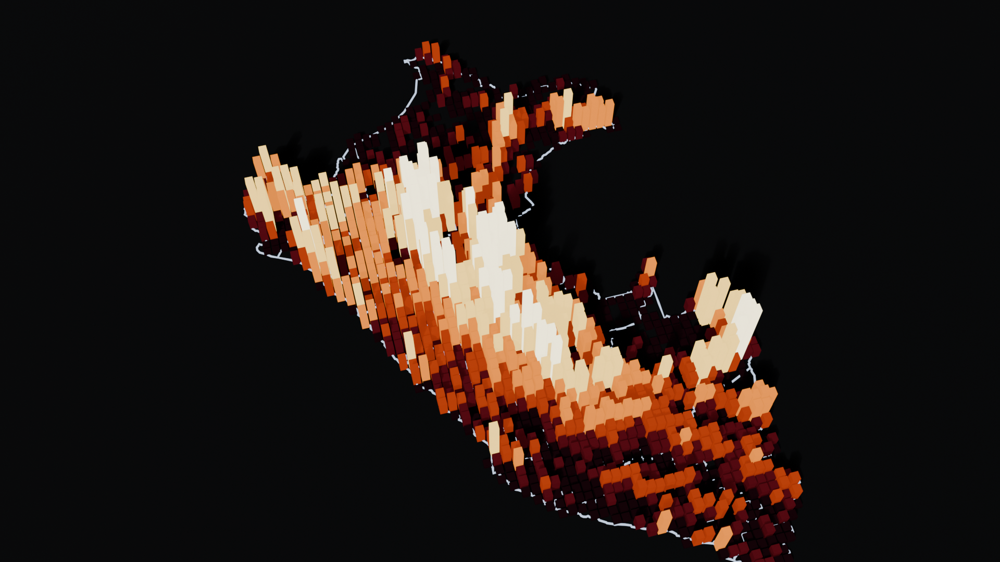

# FireCal Perú: calendario armonizado de quemas

Reto de NASA Space Apps 2026: **Harmonization of MODIS and VIIRS Hot Spots**. Plan completo en [`../09-harmonization-modis-viirs.md`](../09-harmonization-modis-viirs.md).



## Qué resuelve

Los focos de calor satelitales existen desde 2000, pero vienen de dos sensores que **no se pueden comparar** directamente:

- **MODIS** (1 km, desde 2000) está al final de su vida útil.
- **VIIRS** (375 m, desde 2012) es su sucesor y detecta unas **4 veces más** celda-días de fuego.

Si se empalman tal cual, la serie de Perú muestra un salto falso de **+278 % en 2012**. FireCal los armoniza en una sola serie "equivalente VIIRS" de 2000 a 2025 y la presenta como un **calendario de quema** para cualquier área: un departamento, un rectángulo dibujado o uno de los casos predefinidos.

## Resultados (Perú, 2000–2025)

| Métrica | Valor |
|---|---|
| Detecciones procesadas | 358 529 de MODIS y 1 047 074 de VIIRS S-NPP |
| Celda-días con fuego (0.1°) | 201 779 de MODIS y 471 903 de VIIRS |
| Relación VIIRS/MODIS | ≈ 3.5–4.4 entre 2012 y 2024, y **4.97 en 2025** (degradación de MODIS) |
| Salto artificial en 2012 (Perú) | **+278 %** con el empalme crudo frente a **−2 %** armonizado |
| Validación dejando un año fuera, error medio por departamento y mes (MAE) | **88.5 → 26.0** celda-días (sesgo de −74 % a 0.3 %) |
| Error medio del total anual nacional | **7 %** |

Comparación de métodos de calibración. El MAE se mide en departamento × mes, con 3 967 casos:

| Método | MAE | R² (log) | Sesgo |
|---|---|---|---|
| MODIS sin ajustar | 88.5 | −0.02 | −74.4 % |
| k nacional único | 35.4 | 0.66 | 0.1 % |
| k por mes | 31.7 | 0.67 | 0.3 % |
| **k departamento × mes con shrinkage (FireCal)** | **26.0** | **0.70** | 0.3 % |

## Los 3 casos de la demo

| Botón | Hallazgo |
|---|---|
| **Amazonía · Tambopata** | El 82 % de la quema ocurre entre agosto y octubre. 2024 quedó en **+45 %**, el 2.º peor año de 25, y 2020 es el récord. |
| **Andes norte · 2024** | Amazonas, Cajamarca y Áncash: 2024 cerró en **+71 %** (2.º peor año de 25), y en septiembre cada departamento superó su media de ese mes entre +167 % y +206 %. Fue la ola de incendios de 2024. |
| **Costa norte · caña** | Valles cañeros de Lambayeque y La Libertad: la quema es de baja intensidad pero se reparte casi todo el año (pico en mayo–julio). Es un patrón agrícola, no forestal. |

## Método

1. **Métrica común:** se cuenta la *celda-día con fuego* en una grilla de 0.1°. Es binaria por celda y día, así que atenúa la diferencia de resolución entre sensores.
2. **Filtros:** `type = 0` (fuego de vegetación), MODIS con confianza ≥ 30 y VIIRS con confianza nominal o alta.
3. **Calibración** en el solapamiento (febrero 2012 – diciembre 2025): `k = ΣVIIRS / ΣMODIS` por departamento × mes del año. Se aplica shrinkage empírico, `k_d = (ΣV_d + α·k_región)/(ΣM_d + α)` con α = 50, en cadena departamento → macro-región (costa, sierra, selva) → nacional.
4. **Retroproyección:** `MODIS × k` para noviembre 2000 – enero 2012. La banda de incertidumbre sale de un **bootstrap de años** (400 réplicas, percentiles 5–95).
5. **Validación:** se deja fuera un año del solapamiento a la vez (2012–2025).

**Limitaciones conocidas:**
- La regionalización costa/sierra/selva por departamento es gruesa: Arequipa o Cusco mezclan pisos ecológicos.
- La deriva orbital de Terra y Aqua en los últimos años sube el ratio (2025 = 4.97). Una mejora sería calibrar con el ratio de 2012–2019 o modelar la tendencia del ratio.
- No hay modo en vivo (NRT): necesita una MAP_KEY de FIRMS, que cada usuario debe crear.

## Cómo correrlo

```bash
bash pipeline/download.sh
```
Descarga unos 107 MB de CSV anuales de FIRMS (no requiere key).

```bash
python pipeline/build.py
```
Genera `web/data/*.json` en unos 8 segundos. Usa solo la librería estándar.

```bash
python -m http.server 8765 --directory web
```
Abre la app en http://localhost:8765.

Render 3D para el pitch (Blender 5.x, sin interfaz):

```bash
blender -b --factory-startup --python media/blender/hero_scene.py
```
Genera `media/hero.png` y `media/firecal_hero.blend`. Con `-- --frames 120` renderiza un paneo de cámara en `media/frames/`.

## Estructura

```
pipeline/download.sh    descarga FIRMS (archivo anual por país)
pipeline/build.py       armonización, calibración, bootstrap y validación → web/data
web/                    app estática (Leaflet + ECharts), se despliega en GitHub Pages o Vercel
media/blender/          escena 3D para el video y las slides
data/raw/               CSV crudos (no versionar)
```

## Guion del video de 30 s

1. **(0–5 s)** Render 3D: "25 años de fuego en Perú, vistos por dos satélites distintos".
2. **(5–12 s)** Toggle **Crudo**: la serie salta +278 % en 2012. "Ese salto no es fuego, es el cambio de sensor".
3. **(12–18 s)** Toggle **Armonizado**: el salto desaparece y aparece la banda de incertidumbre. Se muestra la validación: error del 7 %.
4. **(18–26 s)** Clic en **Amazonía · Tambopata** → calendario: agosto a octubre en rojo. Clic en 2024: "+45 %, el segundo peor año".
5. **(26–30 s)** "FireCal: para que un guardaparque sepa si este septiembre es normal o una emergencia".

## Fuentes

- NASA FIRMS: MODIS Collection 6.1 y VIIRS S-NPP 375 m, archivos anuales por país. firms.modaps.eosdis.nasa.gov
- Límites departamentales: INEI, vía github.com/juaneladio/peru-geojson
- Mapa base: Esri World Dark Gray Canvas

---
**Archivado (2026-10-13).** Esta fue la v1, solo Perú. La versión vigente es global y está en la raíz del repo (`../../README.md`). Las rutas de estos scripts ya no se mantienen.
