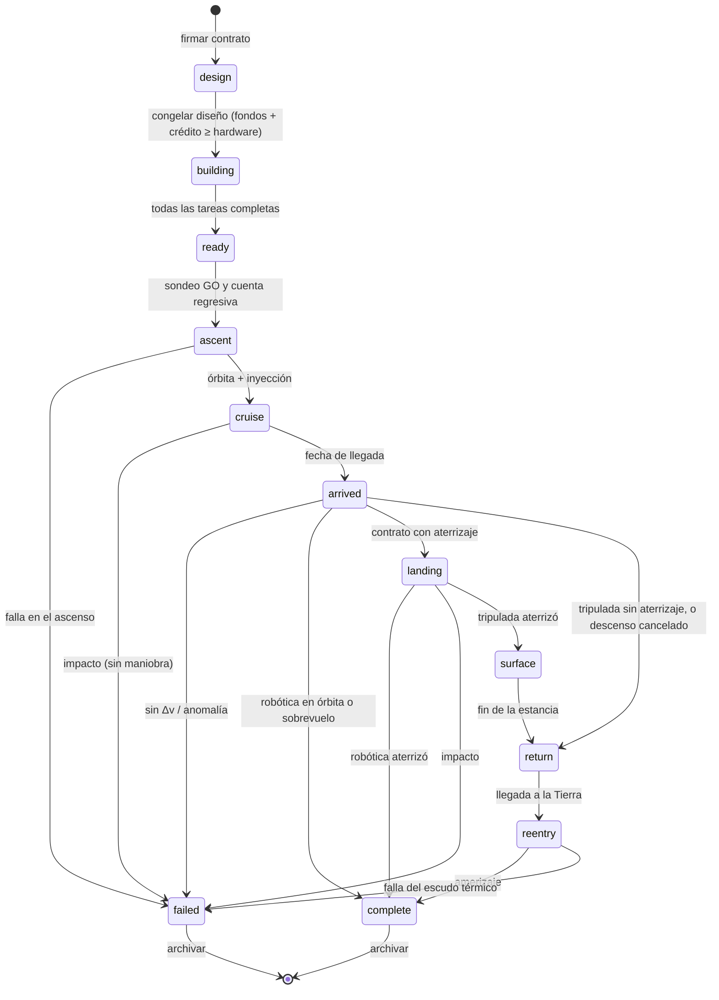

# Δv Mission Control: mapa de la lógica

Este documento describe **cómo funciona el juego por dentro**: qué módulo decide qué, en qué orden pasan las cosas, con qué fórmulas y constantes, y qué está probado. Si cambias una regla, actualiza la sección correspondiente.

Todas las rutas son relativas a `app/src/`.

---

## 1. Capas

```mermaid
flowchart TB
  subgraph Datos
    D1[physics/constants.ts<br/>planetas JPL, constantes]
    D2[data/asteroids.json<br/>7 021 asteroides JPL SBDB]
    D3[data/worlds.ts<br/>fichas NASA, rotación IAU]
    D4[game/catalog.ts<br/>motores, boosters, cargas útiles]
  end
  subgraph Física["Física (pura, con tests)"]
    P1[physics/orbits.ts<br/>Kepler, Hohmann, ventanas, RK4]
    P2[physics/landing.ts<br/>entrada, descenso, aterrizaje]
    P3[game/vehicle.ts<br/>Tsiolkovsky por etapa]
    P4[game/ascent.ts<br/>ascenso 2D a órbita]
    P5[game/hazards.ts<br/>propagación y aproximaciones]
    P6[game/trajectory.ts<br/>ruta de crucero]
  end
  subgraph Reglas["Reglas del juego (puras, con tests)"]
    R1[game/contracts.ts]
    R2[game/assembly.ts<br/>fabricación]
    R3[game/crew.ts<br/>candidatos]
    R4[game/crewcare.ts<br/>tripulación por día]
    R5[game/interior.ts<br/>hábitat por minuto]
    R6[game/campaign.ts<br/>ciclo de la misión, economía]
  end
  subgraph Estado
    S1[game/store.ts<br/>zustand + guardado]
  end
  subgraph Presentación
    U1[app/*.tsx<br/>pantallas React]
    U2[scenes/*.ts<br/>escenas 3D Three.js]
    U3[engine.ts<br/>renderizador y escena activa]
  end
  Datos --> Física --> Reglas --> Estado --> Presentación
```



**Regla de oro:** la física y las reglas **no importan nada de React ni de Three.js**. Todo lo que decide el resultado de una misión vive en funciones puras que se pueden probar con `npx vitest run`. La interfaz solo llama a `store.ts`, y `store.ts` solo llama a `campaign.ts`.

---

## 2. Mapa de módulos

| Archivo | Responsabilidad | Entradas → salidas | Pruebas |
|---|---|---|---|
| `physics/constants.ts` | AU, g₀, día, constante solar, planetas (GM, radio, color, elementos JPL) | — | indirectas |
| `physics/orbits.ts` | Kepler, posición de planetas, Hohmann, Δv desde órbita de aparcamiento, ángulo de fase, próxima ventana, ecuación del cohete, RK4 | fecha → posición; radios → Δv | `orbits.test.ts` |
| `physics/landing.ts` | Entrada, paracaídas, descenso propulsado y grúa aérea (Marte), módulo lunar, sonda Venera | cuerpo → estado paso a paso | `landing.test.ts` |
| `game/catalog.ts` | Motores (clases Merlin, MVac, RS-25, RL10, Raptor, AJ10), boosters, cargas útiles, fracciones estructurales | ids → especificaciones | indirectas |
| `game/vehicle.ts` | Masa por etapa, Δv, empuje/peso, combustión, costo, confiabilidad; requisitos de misión | vehículo → `Performance`, `Readiness` | `vehicle.test.ts` |
| `game/assembly.ts` | Tareas de fabricación, ruta crítica, equipos, pruebas que fallan, proyección | vehículo → `Assembly`; día → avance | `assembly.test.ts` |
| `game/ascent.ts` | Ascenso 2D: gravedad, atmósfera que rota, Max-Q, giro gravitatorio, guiado, separación, fallas de motor | vehículo → estado cada dt | `ascent.test.ts` |
| `game/contracts.ts` | 8 contratos con Δv, crucero, superficie y regreso; ventana de lanzamiento | contrato + fecha → ventana | indirectas |
| `game/trajectory.ts` | Ruta de crucero: Hohmann entre posiciones reales, día de salida óptimo (±45 d), arco lunar | destino + fecha → posición(t) | `store.test.ts` |
| `game/hazards.ts` | Catálogo de asteroides, posición por Kepler, aproximaciones mínimas, Δv de corrección | ruta → encuentros | `hazards.test.ts` |
| `game/crew.ts` | Candidatos con semilla: rol, habilidades, rasgo, salario, entrenamiento | semilla → candidatos | indirectas |
| `game/crewcare.ts` | Tripulación por día: salud, condición física, estrés, dosis, averías, ciencia | estado + día → eventos | `campaign.test.ts` |
| `game/interior.ts` | Hábitat por minuto: horario tipo ISS, desplazamientos, necesidades, reparaciones, enfermería | estado + minuto → estado | `interior.test.ts` |
| `game/campaign.ts` | **Ciclo completo de la misión, economía, reputación, quiebra, biblioteca de diseños** | campaña → campaña + `Effect` | `campaign.test.ts`, `store.test.ts` |
| `game/store.ts` | Estado de la interfaz (pantalla, velocidad, pausa), clonado, guardado en `localStorage` | acción → regla → efecto | `store.test.ts` |
| `engine.ts` | Un renderizador WebGL, etiquetas CSS2D, la escena activa, ganchos por cuadro | — | manual |
| `scenes/solar.ts` | Sistema solar real; en campaña: ruta, nave, marcadores de riesgo, nube de asteroides | fecha → escena | manual |
| `scenes/vab.ts` + `scenes/rocket.ts` | Hangar: cohete procedural, piezas en plano que se llenan con el avance, apilado | vehículo + `Assembly` → escena | manual |
| `scenes/launch.ts` | Plataforma, Tierra a escala real, estela, separación de etapas, cielo según altura | `AscentState` → escena | manual |
| `scenes/landing.ts`, `world.ts`, `orbit.ts` | Aterrizaje, mundo cercano, escuela orbital | — | manual |
| `app/*.tsx` | Pantallas: menú, centro de control, contratos, vehículo, tripulación, hábitat, lanzamiento, operaciones, aterrizaje, informe | estado → interfaz | manual |
| `legacy.ts` + `ui/*.ts` | Simuladores libres (explorador y escuela orbital) | — | manual |

---

## 3. Máquina de estados de la misión



Además, la **campaña** entera termina (`campaign.over`) si la deuda supera la línea de crédito.

### Qué pantalla corresponde a cada fase

| Fase | Pantalla | Reloj de campaña |
|---|---|---|
| `design`, `building` | Vehículo (+ hangar 3D) | corre |
| `ready`, `ascent` | Lanzamiento | detenido durante el ascenso |
| `cruise`, `arrived`, `surface`, `return`, `reentry` | Operaciones | corre |
| `landing` | Aterrizaje | detenido |
| `complete`, `failed` | Informe | detenido |

El reloj corre solo en: centro de control, contratos, vehículo, tripulación y operaciones (`CLOCK` en `app/App.tsx`).

---

## 4. El modelo diario (`campaign.simulateDays`)

Cada día simulado se ejecuta en este orden:

1. **Producción.** Si la fase es `building`: `assembly.stepDay` (equipos por ruta crítica, avance `equipos^0.75 / duración`, fallas de calidad y de pruebas). El gasto del día se descuenta del presupuesto. Una prueba fallida pausa el juego.
2. **Equipos inactivos.** Si no hay fabricación: `0.03 M USD × equipos` por día.
3. **Salarios y entrenamiento.** `salario/365` por astronauta contratado. Los asignados a la misión suben `1 / díasDeEntrenamiento` por día mientras la misión está en tierra.
4. **Intereses.** Si el saldo es negativo: `saldo × 6 % / 365`.
5. **Calendario.** `fecha += 1 día`.
6. **Vuelo** (fases `cruise`, `surface`, `return`):
   - Tripulación: `crewcare.shipDay` (ver §6).
   - `cruise`: se resuelven los asteroides cuya fecha pasó (§5.7); alerta 20 días antes de un objeto en zona de exclusión sin decisión; al llegar, fase `arrived` y pausa.
   - `surface`: al terminar la estancia → `return`.
   - `return`: al llegar → `reentry` y pausa.
7. **Ventanas.** Si pasaron 25 días de la ventana y el vehículo no despegó, se calcula la siguiente (aviso y pausa en destinos interplanetarios).
8. **Solvencia.** Si `presupuesto < −300 M USD` → quiebra.

La simulación se detiene en el primer evento que necesite atención (`Effect.pause`).

---

## 5. Reglas por etapa

### 5.1 Contratos (`contracts.ts`)

| Contrato | Destino | Carga | Trip. | Δv salida | Δv llegada | Crucero | Pago / anticipo | Dific. |
|---|---|---|---|---|---|---|---|---|
| Orbitador lunar | Luna | orbitador | 0 | 3.15 km/s | 0.85 | 4.5 d | 650 / 250 | 1 |
| Aterrizador lunar | Luna | aterrizador | 0 | 3.15 | 2.5 | 4.5 d | 900 / 300 | 2 |
| Orbitador de Marte | Marte | orbitador | 0 | Hohmann + Oberth (≈3.6) | 1.1 | ≈259 d | 1300 / 400 | 2 |
| Rover en Marte | Marte | rover | 0 | ≈3.6 | 0.3 | ≈259 d | 2600 / 700 | 3 |
| Sonda a Venus | Venus | orbitador | 0 | Hohmann | 0.3 | ≈146 d | 1100 / 350 | 2 |
| Sobrevuelo de Júpiter | Júpiter | orbitador | 0 | Hohmann | 0 | ≈2.7 años | 2200 / 600 | 4 |
| Sobrevuelo lunar tripulado | Luna | cápsula | 4 | 3.15 | 0 | 4.5 + 5.5 d de regreso | 2400 / 900 | 3 |
| Alunizaje tripulado | Luna | cápsula + módulo | 4 | 3.15 | 4.3 | 4.5 + 3 en superficie + 4.5 de regreso | 5200 / 1800 | 5 |

- **Desbloqueo:** dificultad ≤ 1 + ⌊reputación / 20⌋.
- **Ventana:** la Luna está disponible cualquier día. Los demás destinos usan el ángulo de fase de Hohmann (`orbits.nextWindow`).
- **Rescindir:** se devuelve el anticipo y se pierden 10 puntos de reputación.

### 5.2 Vehículo (`vehicle.ts`)

- Masa seca de cada etapa: `motores + propelente × fracción(propelente) × (0.7 si es superior) + 400 kg`.
- Fracciones de tanque: queroseno 0.055, hidrógeno 0.075, metano 0.06, hipergólico 0.08, sólido 0.12.
- Isp de la primera etapa sin boosters: promedio entre nivel del mar y vacío + 10 s.
- **Boosters:** fase paralela que dura lo que dura su combustión; la etapa central quema en paralelo su propio flujo.
- **Requisitos (`readiness`):**
  - Δv del vehículo ≥ 9.4 km/s (órbita baja con pérdidas) + Δv de salida.
  - Δv propio de la carga útil ≥ Δv de llegada.
  - Empuje/peso al despegue ≥ 1.15; etapas superiores ≥ 0.15.
  - Asientos ≥ tripulación del contrato.
- **Confiabilidad:** `carga × Π(motor^n × 0.995 por etapa) × booster^n`.

### 5.3 Fabricación (`assembly.ts`)

- Tareas por etapa: motores (`días × (1 + 0.12 (n−1))`), tanques (`30 + 0.12 días/t`), integración (20 d), encendido estático (8 d, éxito `max(0.6, conf^n × 0.96)`).
- Boosters: fabricación + prueba en banco (éxito 0.95).
- Carga útil: fabricación + pruebas ambientales (35 d, éxito 0.9).
- Integración: apilado (21 d) → carenado o cápsula (14 d) → ensayo con combustible (6 d, éxito 0.85) → traslado (3 d).
- **Equipos:** se asignan por la ruta crítica más larga. Un segundo y un tercer equipo por tarea aportan con rendimientos decrecientes (`equipos^0.75`). Las pruebas no aceptan más de un equipo.
- **Contratiempos:** 0.3 %/día de un problema de calidad (+8–20 % de duración). Una prueba fallida reinicia la tarea con `duración × 1.6 + 10` días y el 30 % del costo.
- **Costo:** el costo de cada tarea al iniciarla, más `0.06 M USD × equipos` por día.
- **Congelar el diseño** exige `costo de hardware ≤ presupuesto + 300 M USD de crédito`.

### 5.4 Lanzamiento

- **Sondeo Go/No-Go** (semilla `seed + día × 31 + suspensiones × 7`):
  - Seguridad del campo: falla con 4 %.
  - Meteorología: viento en altura de 5 a 45 m/s; NO GO si es ≥ 33 m/s o si hay nubes de yunque (15 %).
  - Vehículo: empuje/peso y margen de Δv.
  - Nave: Δv de llegada.
  - Dinámica de vuelo: dentro de la ventana (±25 días).
  - Tripulación: todos asignados y entrenados.
- **Suspender** avanza un día y suma una suspensión.
- **Ascenso (`ascent.ts`):**
  - Plataforma a 28.5° N; órbita objetivo de 200 km.
  - Vertical 8 s, luego giro gravitatorio hasta 45 km; después guiado en lazo cerrado sobre la velocidad vertical.
  - Atmósfera: `ρ = 1.225 e^(−h/8 500)`; presión dinámica `q = ½ρv²` respecto del aire que rota con la Tierra.
  - **Fallas:** en cada encendido, `azar > conf^motores` → falla. Con 9 o más motores, el resto compensa (motor inoperativo).
  - Corte del motor (SECO) cuando el perigeo supera 160 km; el Δv restante de la etapa superior se calcula con Tsiolkovsky.
- **Falla en ascenso con tripulación:** la torre de escape salva a la tripulación (−3 de reputación en vez de −8).

### 5.5 Inyección (`campaign.depart`)

- Faltante = `max(0, Δv salida − Δv restante de la etapa superior)`. Lo cubre la nave.
- **Margen** = `Δv propio de la carga − Δv de llegada − faltante`. Con él se pagan las maniobras.
- Se calcula la ruta (`trajectory.planTransfer`) y el predictor corre una sola vez sobre toda la ruta (500 pasos; 60 para la Luna). Se guardan los 24 objetos más cercanos (< 8 millones de km).
- En misiones tripuladas se crea el estado de la nave (`crewcare.initShip`).

### 5.6 Ruta de crucero (`trajectory.ts`)

- Hohmann entre las órbitas medias. El día de salida se elige en ±45 días alrededor de la ventana, buscando el que menos falla el punto de llegada.
- El arco ideal se mezcla suavemente (`s²(3−2s)`) para salir de la posición real de la Tierra y llegar a la posición real del destino, como lo harían las correcciones de trayectoria.
- **Luna:** arco geocéntrico hacia la posición que tendrá la Luna al llegar. En la escena, la distancia Tierra–Luna está exagerada.

### 5.7 Predictor de riesgos (`hazards.ts`)

- Posición de cada asteroide por Kepler de dos cuerpos con los elementos del JPL SBDB (época propia).
- Se descartan los que nunca cruzan la franja radial de la ruta. Para el resto, se busca el mínimo grueso (500 pasos) y se refina por sección áurea (40 iteraciones).
- **Niveles:**
  - `alert`: menos de 2 millones de km (zona de exclusión del juego).
  - `flyby`: menos de 4 millones de km (oportunidad).
  - `watch`: menos de 8 millones de km.
- **Δv de una maniobra** ≈ `distancia / tiempo restante`:
  - Evasión: lleva el paso hasta la zona de exclusión.
  - Sobrevuelo: lo acerca a 5 000 km.
  - Si el costo supera el margen, la maniobra no está disponible.
- **Probabilidad de impacto** (ilustrativa): `(R²/2σ²) · e^(−d²/2σ²)`, con σ = 2 000 km para NEO y 500 km para el resto.
- **Ciencia de un sobrevuelo:** `min(260, 40 + 18 √diámetro_km)`.
- **Diámetro:** el medido si existe; si no, se estima con la magnitud absoluta y albedo 0.14 (`1329/√p · 10^(−H/5)`).

### 5.8 Tripulación en vuelo (`crewcare.ts`, un paso por día)

| Variable | Regla diaria |
|---|---|
| Dosis | +1.8 mSv en espacio profundo (MSL/RAD); +1.0 en tránsito lunar. Límite de carrera: 600 mSv |
| Averías | Cada sistema sano tiene 1/6 de probabilidad diaria de caer a 35–60 %. Se repara `15 + 7 × ingeniería` puntos por día |
| Enfermedad | 1/12 por día para la tripulación; la salud baja a 65 y sube `2 + 0.8 × medicina` por día hasta el alta |
| Condición física | −0.03/día con gimnasio (energía > 50 %); −0.6/día si está enfermo o sin gimnasio |
| Estrés | +0.3/día (+0.15 si es resistente al aislamiento), −0.12 con comunicaciones, −0.015 × liderazgo, +1.5 si falla el soporte vital |
| Salud | +0.5/día con soporte vital; −1.2 sin él; −0.4 si el estrés > 80 |
| Ciencia | Σ (ciencia/10) × (1.2 si es científico, 0.35 si no) × (1 − estrés/200), salvo enfermos |

- **Apto para el descenso:** nadie con salud < 45 y nadie por encima del límite de dosis. Si no, el **descenso se cancela** y la tripulación regresa (misión no cumplida, −3 de reputación).
- **Hábitat por minuto (`interior.ts`):** solo corre mientras el jugador lo mira. Arranca con el estado diario (`Habitat.tsx → seeded`), así que ambas vistas coinciden.

### 5.9 Llegada, aterrizaje, regreso (`campaign.arrive`, `landed`, `reenter`)

1. Si el margen < 0 y hay maniobra de llegada → la nave pasa de largo (fallida).
2. **Anomalía** con probabilidad `(1 − confiabilidad de la carga) × (1 − ingeniería máx./20)` (semilla `seed + 4242`).
3. **Tripulada sin aterrizaje:** +150 de ciencia → regreso.
4. **Con aterrizaje:** escena de aterrizaje (física de `landing.ts`; en la Luna se puede pilotar a mano).
   - Robótica que aterriza → cumplida.
   - Tripulada que aterriza → superficie, con ciencia de actividades extravehiculares `Σ ciencia × días × 6`.
   - Impacto → fallida; si era tripulada, **se pierde la tripulación**.
5. **Reentrada:** éxito 99.5 % (escudo térmico y paracaídas). Informa la dosis máxima de la tripulación.

### 5.10 Cierre y reputación (`campaign.finishMission`)

| Resultado | Pago | Reputación | Ciencia |
|---|---|---|---|
| Cumplida | pago del contrato | +8 + 5 × dificultad (máx. 100) | contrato + ruta + a bordo |
| Fallida (robótica) | — | −8 | 50 % de lo obtenido en ruta |
| Tripulación a salvo tras una cancelación | — | −3 | 50 % |
| Tripulación perdida | — | −25; los astronautas quedan "en memoria" | 50 % |

Los astronautas que vuelven suman un vuelo (el próximo entrenamiento dura 50 días menos, con un mínimo de 90).

### 5.11 Economía

| Concepto | Valor |
|---|---|
| Presupuesto inicial | 1 500 M USD |
| Línea de crédito | 300 M USD; por encima → quiebra |
| Interés de la deuda | 6 % anual |
| Equipo de ingeniería | 0.06 M USD/día fabricando; 0.03 M USD/día inactivo |
| Contratar a un astronauta | 1.5 M USD + salario (0.15–0.35 M USD/año) |
| Biblioteca de diseños | hasta 12, uno por nombre |

---

## 6. Aleatoriedad reproducible

Todo el azar sale de `rng.ts` (mulberry32) con semillas derivadas de la campaña, así que **una misma partida da los mismos resultados**:

| Evento | Semilla |
|---|---|
| Candidatos a astronauta | `seed` |
| Fabricación (calidad y pruebas) | `seed + día × 7919` |
| Sondeo Go/No-Go | `seed + día × 31 + suspensiones × 7` |
| Fallas en el ascenso | `seed + día × 13 + 5` |
| Tripulación a bordo | `seed × 3 + día` |
| Impacto con un asteroide | `seed + día` |
| Anomalía de llegada | `seed + 4242` |
| Reentrada | `seed + 777` |
| Hábitat por minuto | `tripulantes × 977 + 13` |

---

## 7. Guardado

- `localStorage["dv-mission-control-v1"]` guarda la campaña completa en JSON. Se escribe al cambiar de pantalla, después de cada acción, cada 30 días simulados y al cerrar la pestaña.
- `campaign.migrate()` completa los campos que no existían en partidas antiguas. Si agregas un campo a `Campaign` o `Mission`, agrégalo ahí también.
- El guardado vive en el navegador de cada PC: **no viaja con el USB**.

---

## 8. Pruebas

```bash
cd app && npx vitest run
```

| Archivo | Qué garantiza |
|---|---|
| `physics/orbits.test.ts` | Efemérides contra JPL Horizons, Hohmann Tierra–Marte, Oberth, Juno, Tsiolkovsky, RK4 |
| `physics/landing.test.ts` | Tiempos y velocidades de contacto en Marte, Luna y Venus |
| `game/vehicle.test.ts` | Clase Falcon 9 a Marte con orbitador; no levanta la cápsula; clase SLS a la Luna con cápsula |
| `game/assembly.test.ts` | Ruta crítica, más equipos = antes, pruebas fallidas = retrabajo |
| `game/ascent.test.ts` | Clase Falcon 9 en órbita con Max-Q realista; cápsula imposible; SLS con separación de boosters |
| `game/hazards.test.ts` | Ceres, Vesta y Eros contra Horizons (< 0.002 UA), Δv de evasión |
| `game/interior.test.ts` | Horario, reparaciones y atención médica en el hábitat |
| `game/store.test.ts` | Ruta a Marte; campaña lunar de punta a punta; predictor en un crucero a Júpiter |
| `game/campaign.test.ts` | Dosis y salud de la tripulación; alunizaje tripulado completo; pérdida de tripulación; crédito, quiebra e intereses; biblioteca; migración; ventanas |

---

## 9. Pendiente (ideas ordenadas por valor)

1. **Contratos que caducan y se renuevan** con destinos y pagos variables.
2. **Reutilización:** primera etapa recuperable (aterrizaje propulsado) que abarata el siguiente vuelo.
3. **Seguro de lanzamiento:** pagar una prima para recuperar parte del costo ante una falla.
4. **Misiones tripuladas a Marte** (necesitan hábitat de tránsito, ~2.5 años y mucho más Δv).
5. **Conexión con la base** (sandbox *Junior Astronaut*): llevar al alunizaje la base diseñada allí.
